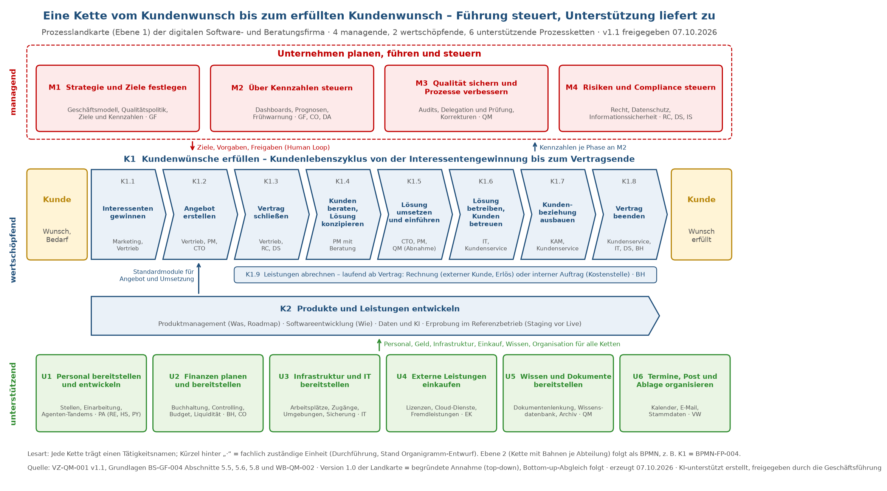
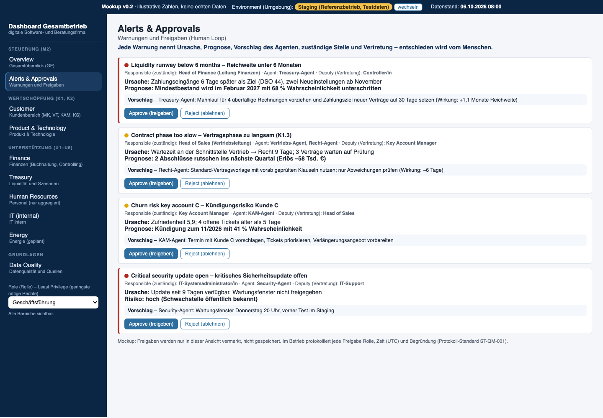

# Claude Code & BPMN – Multi-Agenten-System für Unternehmensprozesse mit Human-in-the-Loop

Wie arbeiten Menschen und KI-Agenten in einem Unternehmen sinnvoll zusammen – sicher, nachvollziehbar und mit klarer Verantwortung? In diesem privaten Projekt baue ich dafür eine **digitale Firma** auf: Jede Stelle ist ein **Tandem aus Mensch und KI-Agent**, die Abläufe sind als Prozesse modelliert, und wesentliche Entscheidungen trifft immer ein Mensch (**Human Loop**).

🔒 Privates, laufendes Projekt – hier zeige ich nur, woran ich arbeite. Details stelle ich gern im persönlichen Gespräch vor.

## Woran ich arbeite

- **KI-Agenten mit klaren Rollen:** Aufgaben, Grenzen und Freigaben je Agent – wie bei einer Stellenbeschreibung
- **Prozessmanagement:** Prozesslandkarte und Prozessketten in BPMN 2.0 (Business Process Model and Notation) vom Kundenwunsch bis zur Abrechnung
- **Organisationsentwicklung:** Organigramm, Rollen und Zuständigkeiten, abgeleitet aus den Prozessen
- **KI-Governance (Steuerung und Kontrolle):** DSGVO, EU AI Act, Informationssicherheit und Qualitätsmanagement als feste Leitplanken für jeden Agenten
- **Daten und Dashboards:** Kennzahlen, Frühwarnung und Prognosen als Entscheidungshilfe für die Führung ([Beispiel: Management-Dashboard](https://github.com/Mathias-Stumpf2026/finanz-dashboard-gesamtbetrieb))

## Beispiel: Der Mensch entscheidet

Der Agent erkennt ein Risiko, nennt Ursache, Prognose und einen Vorschlag – freigeben oder ablehnen kann nur die zuständige Person.

## Praxisnutzen im Unternehmen

- KI schrittweise und **regelkonform** einführen, statt einzelne Werkzeuge ohne Gesamtbild zu nutzen
- Prozesse erst **verstehen und verbessern**, dann automatisieren
- Verantwortung, Freigaben und Nachweise so gestalten, dass sie auch einem **Audit** standhalten

## Werkzeuge

Claude Code (Anthropic) · Python · BPMN 2.0 · Git · Markdown und Word · Bezugsrahmen DSGVO, EU AI Act, ISO 9001, ISO/IEC 27001

## 📧 Kontakt

Siehe mein [GitHub-Profil](https://github.com/Mathias-Stumpf2026) – ich freue mich über Fragen und Austausch.

---

## English Summary

How can people and AI agents work together in a company – safely, traceably and with clear accountability? In this private project I am building a **digital company** in which every position is a **human + AI agent tandem**, workflows are modelled as business processes (BPMN 2.0), and every material decision is made by a human (**human-in-the-loop**).

**Topics:** AI agents with defined roles and limits · process management · organisational design · AI governance (GDPR, EU AI Act, information security) · dashboards and forecasting.

Private, ongoing project – happy to present details in person.
